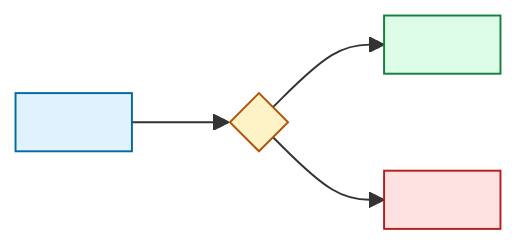

# <Feature>

Approved <UTC date> at `<revision>`. Notebook: [thinking](thinking.md).

## Request

> <The user's own words.>

## Goal

<The goal sentence, then two or three sentences on why it matters and how it differs from the request.>

## How it works

### Step by step

| Step | What happens | Edge cases and choices here |
| --- | --- | --- |
| 1 | <who does what, what data moves> | <case → what happens, because why> |

### One example

<A fictional person walked through every step, with the data they see.>

## Learn

### <Idea>

- **What it is:** <plain words and an everyday comparison>.
- **How it works:** <the method or algorithm in numbered steps>.
- **The thinking:** <the reasoning that leads to it>.
- **Why here:** <what it solves in this feature>.
- **When not:** <where it is the wrong tool, and what we would use instead>.

### Architecture tour

<Mermaid picture of the services and data involved; each arrow says what travels and what happens when it fails.>

## Scope

- **Building:** <part → the goal words it serves>.
- **Not building:** <part → why not>.
- **Later:** <part → why it waits>.

## Rules

- <Rule or lesson that binds this delivery, from `.agents/rules/`, the lessons, or the user, with its source.>

## Choices

| Choice | Why | Instead of |
| --- | --- | --- |
| <choice> | <reason> | <rejected options> |

## Risks

| Risk | Softened by | Sign we would see |
| --- | --- | --- |

## Done when

1. <Condition anyone can check.>

## Predictions

- Riskiest step: <step and why>.
- Expected: <steps> steps, <files> files, about <minutes> minutes, <n> verify runs.
- Each risk above has its sign; the close stage scores every prediction in `outcomes.md`.

## Steps

1. <Concrete step: files or owner paths it touches, and how it is verified in the `scripts/dc` form. [steps](steps.md) holds each step in full.>

## Delivery at a glance

<Steps, the riskiest step, and what the user does at the end; filled after the steps are written.>
